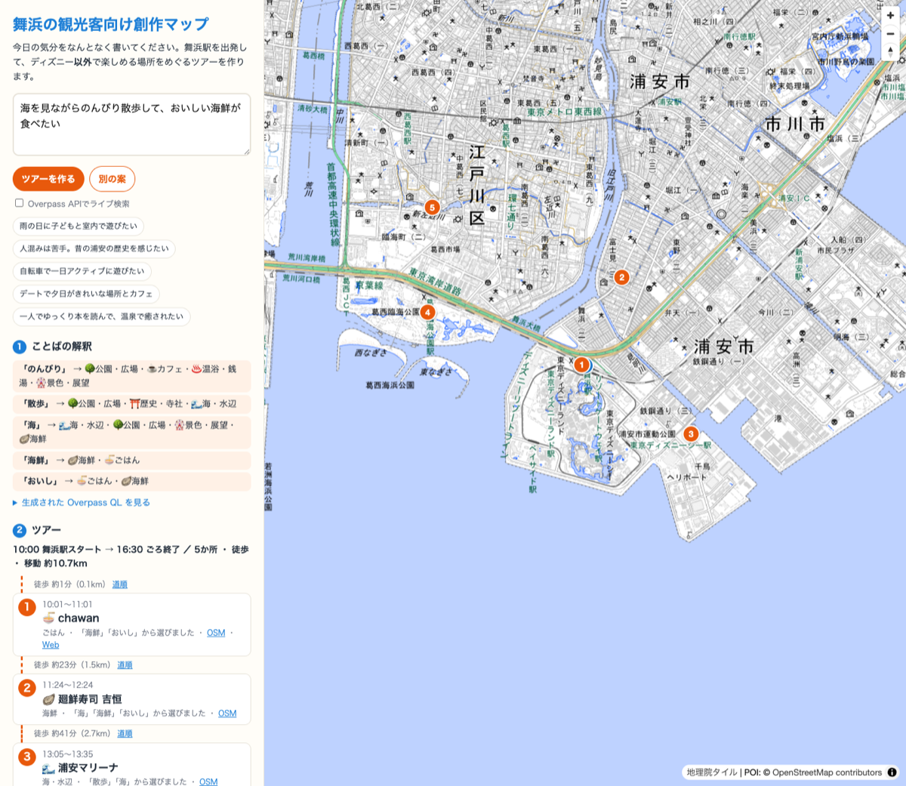

# 舞浜の観光客向け創作マップをつくりました（FOSS4G Hiroshima 振り返りハッカソン）

<!-- グラレコ画像をここに：images/graphic_recording.jpg -->


## 1分でいうと

- 「なんとなくの気分」を書くと、**舞浜駅スタートでディズニー以外**を回るツアーマップができます
- FOSS4G Hiroshima の **TRIDENT**（文章 → Overpass QL → OpenStreetMap → 地図）のしくみを初めて試しました
- AI は Claude Code だけというルールなので、LLM の代わりに**辞書ルール**で「文章 → クエリ」を再現しました

▶ デモ：https://furuhashilab.github.io/Hackathon_Oct_Miwa/
▶ リポジトリ：https://github.com/furuhashilab/Hackathon_Oct_Miwa

## なぜ作ったか

舞浜は私の地元です。観光客の多くはディズニーに来ますが、浦安には漁師町の歴史が残る旧宇田川家住宅や郷土博物館、海辺の公園、銭湯、海鮮のお店など、ほかにも楽しめる場所がたくさんあります。でも「どこに行きたいか」をはっきり言える人は少ないので、**なんとなくの気分**から行き先を見つけられるようにしたいと思いました。

## 参考にした発表

FOSS4G Hiroshima 2026（9/2）
**Building an AI Map Agent with Self-Hosted Planet-Scale OSM and Tiny LLMs**（Yui Matsumura）
https://talks.osgeo.org/foss4g-2026/talk/78TXXS/

「広島市のカフェを見せて」のような文章を LLM で Overpass QL に変換し、OpenStreetMap から実データを取り出して地図にする AI 地図エージェント **TRIDENT** の発表でした。

## しくみ

```
なんとなくの文章 → ことばの解釈（辞書ルール） → Overpass QL → OpenStreetMap → スコアリング → ツアーマップ
```

1. **ことばの解釈**：「のんびり」→ 公園・カフェ・温浴、「海」→ 水辺・展望、「雨」→ 屋内優先 のように変換します。「人混みは苦手」のような否定は「避けたい」として扱います
2. **Overpass QL の自動生成**：好みのカテゴリの OSM タグからクエリを組み立てて画面に表示します（ライブ検索も可能）
3. **ディズニーの除外**：OSM のテーマパーク・ホテルのポリゴン内にある点はすべて除外します
4. **ツアーづくり**：好み × 知られている度（wikidata などのタグ）× 舞浜駅からの距離でスコアを付け、カテゴリが偏らないように選び、近い順に回ります



左側に「ことばの解釈」と時刻つきのツアー、右側の地図に立ち寄り順の番号が出ます。

## 試してみた例

| 入力 | できたツアー（抜粋） |
|---|---|
| 海を見ながらのんびり散歩して、おいしい海鮮が食べたい | 浦安マリーナ → 葛西臨海公園 → 海鮮のお店 … |
| 人混みは苦手。昔の浦安の歴史を感じたい | 浦安市郷土博物館 → お寺 … |
| 雨の日に子どもと室内で遊びたい | 葛西臨海水族園 → 角野栄子児童文学館 … |

## Claude Code を使ってみた感想

<!-- 下書きです。自分の言葉に直してください -->

今回は、コードを書くのも GitHub の操作も、ほぼすべて Claude Code に頼みました。自分がやったのは「何を作りたいか」を日本語で伝えることと、途中で出てくる選択肢を決めることです。

- **会話だけで形になる**：「広島の FOSS4G の、なんとなくの文章から行きたい場所を探す発表を使って、地元の舞浜でディズニー以外のツアーマップを作りたい」と伝えただけで、発表の候補探し、データ取得、地図アプリ、README、ライセンスまで一通りできあがった
- **聞き返してくれる**：参考にする発表の候補を2つ出して「どちらですか？」と聞いてくれたり、「AI は Claude Code だけ」というルールに引っかからない作り方（辞書ルール方式）を提案してくれたりした
- **途中で方針を変えても対応してくれる**：作業の途中でタイトルを「舞浜の観光客向け創作マップ」に変えてほしいと頼んだら、そのまま反映してくれた

## 苦戦したところ

- **参考にした発表を探す**：記憶していたのは「なんとなくの文章から行きたい場所を見つけるアプリ」というあいまいな内容だけ。プログラムは英語のタイトルが多く、自分の記憶とぴったり一致する発表がなかった。Claude Code に候補を絞ってもらい、最終的に自分で TRIDENT の発表に決めた
- **GitHub との連携**：Mac に GitHub CLI（gh）が入っておらず、まずインストールから。さらに「ログインできた」と思ったら、このパソコンの gh にはログインできていなかった。ターミナルでコードを入力してブラウザで許可する手順を、もう一度やり直した
- **公開 Overpass API が混んでいる**：OSM のデータ取得がタイムアウトを何度も繰り返した。クエリをカテゴリごとに小さく分けて取得し直し、取得済みのデータをアプリに同梱することで対応した
- **ディズニーが混ざる**：OSM には園内のアトラクションまで細かく登録されていて、最初は候補にディズニーの施設がたくさん出てきた。名前だけでなく、パークとホテルの**区域（ポリゴン）**の中にある場所をまとめて除外するようにした
- **「ディズニー以外で」の落とし穴**：「以外」を「避けたい」という否定として読んでしまい、後ろの「遊べる」まで消えてしまうバグがあった。「ディズニー以外で」は前提条件として最初に取り除くように直した

## 学んだこと

<!-- 下書きです。自分の言葉に直してください -->

- **AI に任せても、決めるのは自分**：どの発表を参考にするか、ハッカソンのルールに合っているか、コミットに使う名前とメールアドレスなど、大事な判断は毎回自分に聞かれた。何を作りたいかがはっきりしているほど、話が早く進む
- **TRIDENT のしくみ**：「文章 → Overpass QL → OSM → 地図」と段階を分けると、途中のクエリを画面に出せるので、なぜその場所が選ばれたのかを説明しやすい。LLM がなくても辞書ルールでかなり再現できた。ただ、辞書にない言葉には弱い
- **公開 API とデータの現実**：発表者が自宅でプラネット規模の OSM サーバーを動かしていた理由がよく分かった。公開サーバーは混雑するので、負荷をかけない工夫と、つながらないときの代わりのデータが必要
- **オープンデータのライセンス**：OSM は ODbL、地図タイルにも出典表示が必要。自分の成果物（CC BY 4.0）と、使わせてもらったデータのライセンスを分けて書く必要がある
- **次にやりたいこと**：TRIDENT のように小さなローカル LLM で文章の解釈を置き換えて、辞書にない言葉にも対応したい。浦安の漁師町の歴史スポットの紹介文も足したい

## クレジット

- 参考発表：Yui Matsumura「Building an AI Map Agent with Self-Hosted Planet-Scale OSM and Tiny LLMs」（FOSS4G Hiroshima 2026）
- データ：© OpenStreetMap contributors（ODbL）／ 背景地図：地理院タイル ／ 地図ライブラリ：MapLibre GL JS
- 開発：Claude Code を使用
- ライセンス：CC BY 4.0
